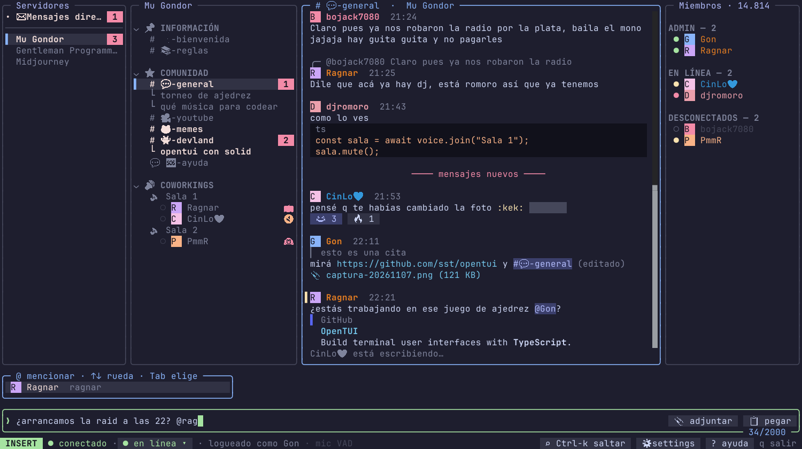
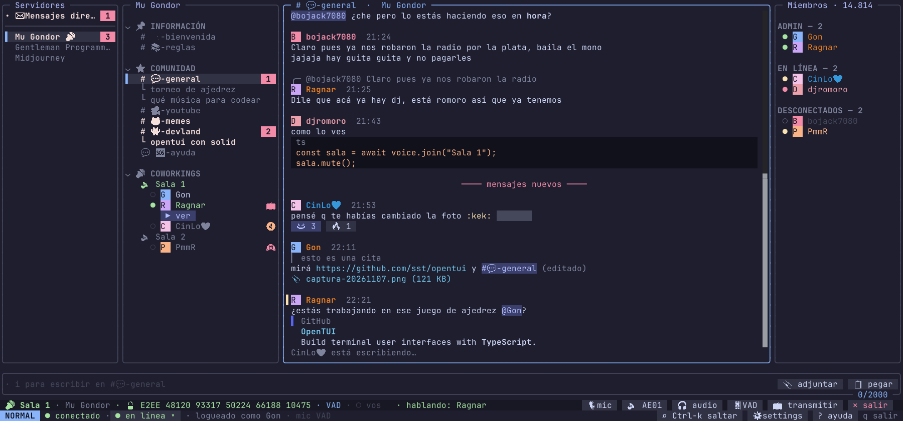
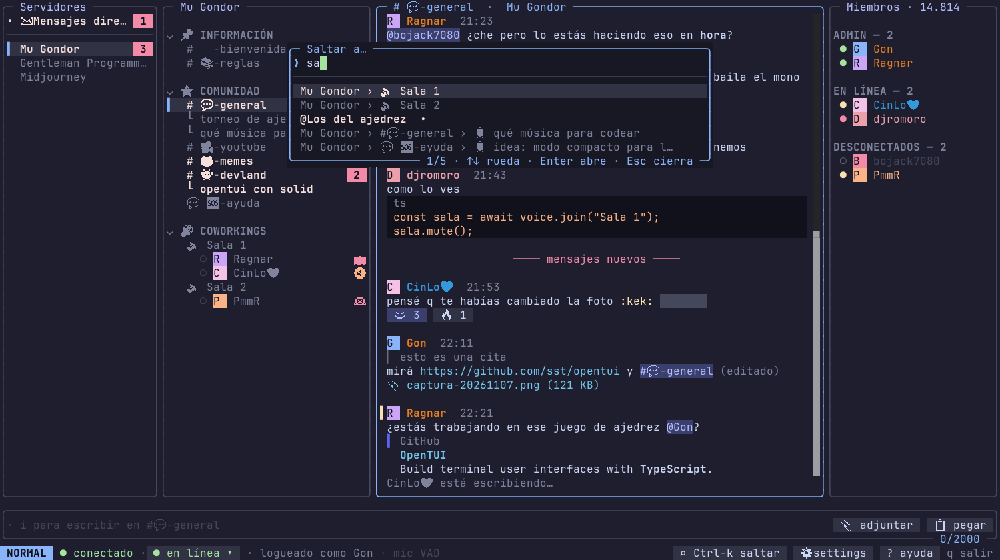
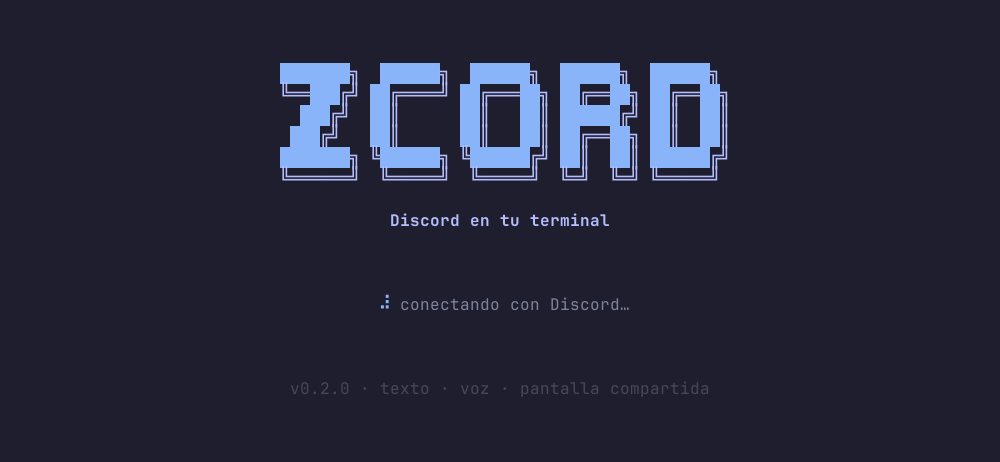

# zcord

**Discord en tu terminal.** Texto, voz con cifrado de punta a punta, pantalla compartida y transmisiones, todo sin
salir de la terminal. Se usa con el mouse como Discord o con el teclado estilo vim.



## Features

- **Chat completo:** servidores, canales, DMs y grupos, hilos y foros. Incluye markdown, bloques de código,
  respuestas, edición, borrado, reacciones, menciones con `@`, emojis personalizados, stickers, encuestas,
  embeds y la línea de "mensajes nuevos".
- **Imágenes en la terminal:** avatares, GIFs animados y emojis con el protocolo gráfico de Kitty.
- **Adjuntos:** pegá con `Ctrl-v` una captura o archivos copiados en el gestor de archivos, o adjuntá un archivo
  por ruta.
- **Voz:** entrás con un click y ves quién habla. Tiene E2EE (DAVE) con código de privacidad, VAD o push-to-talk,
  mute, ensordecer, volumen por persona, salida de audio a elección y sonidos de eventos.
- **Chat de los canales de voz,** sin tener que entrar a la llamada.
- **Pantalla compartida (Go Live):** elegís qué monitor transmitir.
- **Ver la transmisión de otros** dentro de la terminal.
- **Todo clickeable** (sin ids que tipear), con `Ctrl-k` para saltar a cualquier canal, tu estado
  (en línea / ausente / no molestar) y listas de miembros grandes.

| Voz y transmisiones | Saltar a cualquier lado (`Ctrl-k`) |
| --- | --- |
|  |  |



## Cómo correrlo

Requisitos:
- Linux con PipeWire y Wayland.
- [Bun](https://bun.sh) ≥ 1.3.14.
- Una terminal con protocolo Kitty: Ghostty o Kitty.
- Opcionales: `wl-clipboard` (pegar), `wf-recorder` o `ffmpeg` (pantalla compartida).

```sh
bun install
bin/zcord          # la app (la primera vez: login con QR o token)
bin/zcord demo     # la UI con datos falsos, sin conectarse a Discord
```

Para tenerlo en el PATH: `ln -s ~/projects/discord-tui/bin/zcord ~/.local/bin/zcord`. Dentro de la app, `?` muestra
todas las teclas.

> ⚠️ zcord entra con tu cuenta personal (no es un bot). Eso va contra los Términos de Discord y la cuenta puede
> terminar suspendida. Usalo sabiendo ese riesgo.

## Desarrollo

```sh
bun test                       # tests (UI con testRender, sin red)
bun run typecheck
bun scripts/screenshots.tsx    # regenera las capturas de este README desde la demo
```

- Las notas del protocolo están en `docs/protocol-notes.md`.
- La checklist de pruebas con la cuenta real está en `docs/PRUEBAS-GON.md`.
- Las reglas del repo (token, fixtures redactados) están en `AGENTS.md`.
